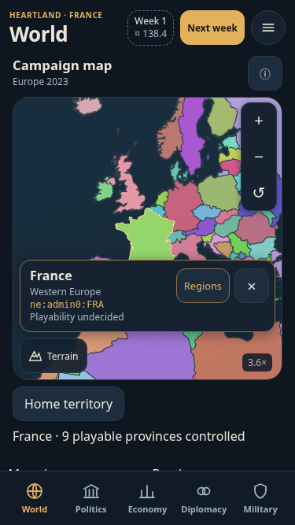
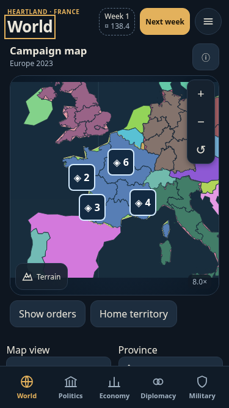
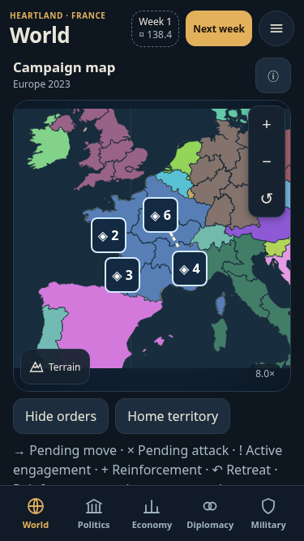

# GEO-01 · Unified campaign geography

Europe 2023 uses the same mounted atlas, WebGL globe and geographic camera before and after selecting a country. Starting a match animates the existing camera to the selected country. A camera-matched 220 ms dissolve shares the same focus, local scale and orientation across the globe and flat view. The projection exit threshold is 82% of the viewport-adjusted entry threshold. The camera retains its geographic context across panel navigation and resizing, and the map retains its selected province. The existing Windows, Mac and fictional paths continue using their existing geographic and fictional-map controls.

## Geography and permissions

- The detailed layer uses the same Natural Earth 5.1.1 Admin-1 shapes and scenario member IDs as WORLD-04. It dissolves internal Admin-1 outlines when several source shapes make up one of the 46 playable provinces. Province fills and control counts read game state. Military, land and maritime adjacency remain separate, as does movement validation.
- Military counters are absent from the globe. The flat view clusters viewer-owned formations within 45 screen pixels of the first visible province anchor. The anchor is a representative point in the province, consistent with province-level locations. The Military tab and map share one selection. Select across provinces, select available formations in one province, or locate a formation from the Military tab.
- Order overlays start hidden and do not control counter visibility. The map distinguishes pending move, pending attack, active engagement, reinforcement and retreat using symbols and strokes. The isolated review shows labeled reinforcement and retreat examples. Real pending legacy orders and active attacks use player-authorized data. A completed strategic retreat event identifies only its destination, so the overlay displays a symbol there.
- The 90-marker stress view is a display fixture on the owner review origin. It repeats known owned placements and does not represent opposing formations or change game state. Its counters are noninteractive.
- Existing React, TypeScript, Vite, WebGL and SVG renderers and existing Natural Earth atlas assets are reused. No new dependencies or geographic datasets. Existing scenario package identity, geographic asset licences and distribution allowlist apply. [Geographic sources and terms](../geography/README.md)

## Review evidence

| Global inspection | Detailed Europe | Orders enabled |
|---|---|---|
|  |  |  |

The browser test checks that the viewport is the same DOM element throughout, observes intermediate opacity during the projection dissolve, and verifies both endpoints, orientation changes, and division selection and locate. The owner build runs without opening persistent save storage.

## Physical iPhone acceptance

1. Open the owner review URL in Safari, verify the build label, and rotate and pinch the globe before starting a game.
2. Tap **New game**. Tap France on the globe or choose it from the list. Tap **Start local scenario**. Check that the same view zooms into provinces smoothly.
3. Tap a counter and select two formations. Open **Military → Map selection**, verify the selections, and use **Locate** for an owned formation. Confirm the map centers on its province.
4. Turn **Show orders** on and off. Check that the formation counters stay visible in 2D and reinforcement and retreat examples are labeled as fixtures. Zoom out to the globe. Check that no counters remain and the same province is selected when you zoom in again.
5. Repeat in landscape. Check that the map, scrolling and turn controls remain usable. Gather physical timings before approving the rendering targets. [Accepted simulation limits and earlier iPhone benchmark](../military/MIL-00-ENGINE.md#benchmark-measurements)

## Rendering targets for review

Proposed goals for the iPhone SE (2022), measured separately from the five unchanged simulation limits. Cold geographic startup to interactive globe ≤ 2,000 ms. Settled wheel/pinch or drag feedback within two display frames under normal load. Country start to settled detail ≤ 2,500 ms on a warm geometry cache. Tap to selection feedback and orientation relayout each ≤ 250 ms. Idle geometry should schedule zero frames after settling. Review heap trends after repeated navigation and rotation. Browser heap figures exclude GPU allocations and cannot establish device memory use.

The projection dissolve changes the shape of geography near the edges. Globe-unavailable devices use the existing flat fallback. The geographic view keeps selection for the running match, while save records retain the existing game-only schema. Strategic order entry remains part of MIL-00-UX.
