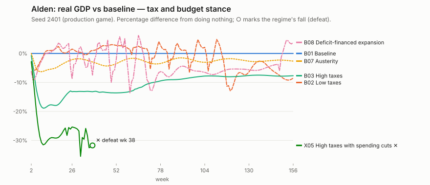
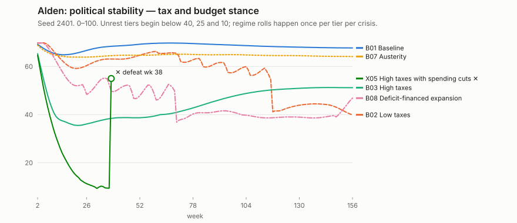
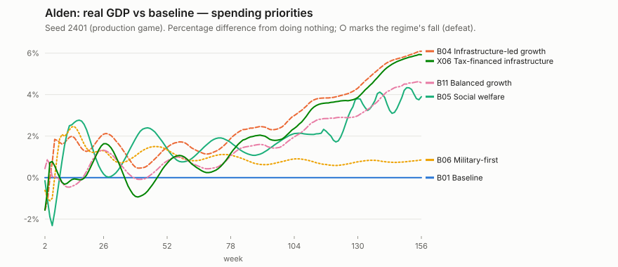
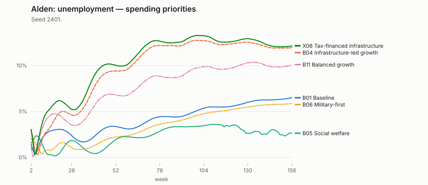
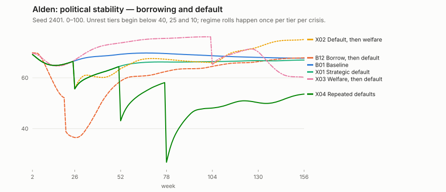
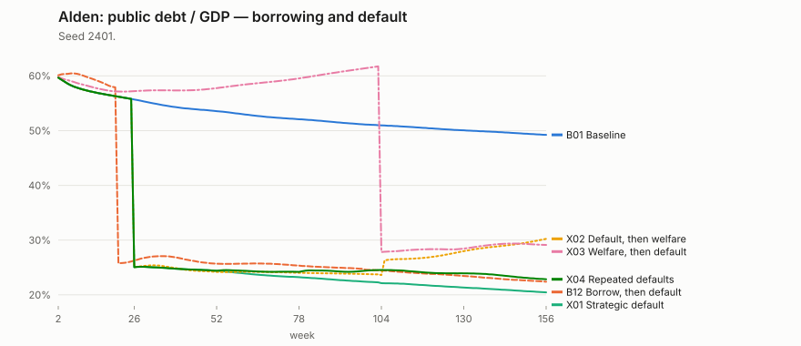

# ECON-06 — Economic Gameplay Balance and Strategy Analysis

| | |
|---|---|
| **Type** | Analysis only. No formula, constant, calibration, game, UI or geography file was changed. |
| **Branch** | `analysis/econ-06-balance`, from `main` at `3e1f359` (PR #26 merged) |
| **Engine version analysed** | The `economy-engine/` on `main`, identical to the handoff (contract 1.0.0, golden fingerprint `6f9bf1a361044b05`) |
| **Reproduce** | `cd economy-engine && npm run econ06:balance`. It runs in about 4½ minutes and rewrites `reports/econ06_balance.json`, `reports/ECON_06_BALANCE_DATA.md` and `reports/econ06-charts/*.svg`. |
| **Script** | [`sim/econ06-balance.ts`](sim/econ06-balance.ts) |
| **Full data** | [`reports/ECON_06_BALANCE_DATA.md`](reports/ECON_06_BALANCE_DATA.md) has every strategy for every country at weeks 52, 104 and 156, sector output, defaults, the AI comparison, spillovers and the 20-seed defeat sweep. |

The earlier exploratory pass (branch `analysis/econ-06-gameplay-validation`, report `ECON_06.md`) is superseded by this report. Its conclusions are confirmed here with the production start path, a defeat rule, sector and infrastructure data, an AI comparison and a 20-seed defeat sweep.

---

## 1. Executive summary

**The engine is internally consistent.** In 225 detailed runs and 900 sweep runs I found no accounting error:
- The treasury and the debt move exactly as the published budget says, to within 10⁻¹².
- Every week passes the engine's conservation audit.
- Runs are exactly reproducible.
- The production starting save gives the same economy as a freshly built one.

**Most moderate strategies produce real trade-offs**, which is the goal:

| Strategy | Gain | Cost |
|---|---|---|
| Infrastructure-led growth | best GDP (+6.1% by week 156) | unemployment 12% and stability −9 |
| Balanced growth | GDP +4.6% and lower debt | stability −5 |
| Social welfare | stability 75 | debt/GDP 67% and a 10.6% borrowing rate |
| Low taxes | a year-one boom | market closure and forced defaults in two of three countries |
| Austerity | debt/GDP 33% | GDP −2.7% |

Over 52, 104 and 156 weeks the economy reacts quickly and visibly: GDP moves by 1% within 0–5 weeks of a tax or spending change.

**But five balance problems make some choices traps and others exploits:**

1. **Tax rises and budget surpluses cause a fast collapse that cannot be undone.**
   - Maximum taxation ends the game in **60 of 60** sweep games (median week 17).
   - Taxes +10 points with spending unchanged gives GDP −7%, unemployment 13.6%, and defeat in 7 of 60 games.
   - Undoing maximum taxation after only 8 weeks still ends in defeat in **41 of 60** games.
   - The cause is a feedback loop, not an accounting error. Spending is a share of smoothed GDP, so it shrinks as the economy shrinks. The surplus repays bondholders or sits in the treasury instead of being spent.
2. **A first default is a cheap reset.**
   - "Borrow heavily, then default" ends the game with GDP −0.7%, stability 66 and debt halved.
   - "Default, then welfare" gives the **highest stability of any strategy (76)** and no defeats in 60 games.
   - A deliberate default beats austerity on GDP, debt and stability.
3. **Social spending removes almost all political risk.** At 18% of GDP, stability stays at 74–76, with no unrest week and no defeat in 60 games. The bonus rises in a straight line with spending, up to the 50% limit. The only cost is debt.
4. **The permitted limits let a player end their own game in 3–4 months.** Maximum taxation or maximum spending (orders worth 200% of GDP, of which only 3% can be paid) is defeat in every run. The limits are accepted silently.
5. **Opportunity costs are mis-signalled.**
   - Infrastructure raises unemployment because it saves labour faster than it creates demand. By week 156 it gives the largest GDP gain of any strategy, but players will read the unemployment as failure.
   - Quadrupling military spending is economically free (GDP +0.5%, debt +13 points).
   - "Small state" (taxes halved and spending cut by 30%) beats the baseline on GDP, unemployment and consumption at little cost within three years.

**Serious defects:** none in accounting, determinism or stability of the code. The surplus loop in issue 1 is the closest to a defect. The code says money should not "pile up idle in a treasury", but once the debt is repaid it does.

**AI countries** behave reasonably but passively. The autopilot tracks a passive player almost exactly (GDP ±0.1%, stability ±1). It never invests, defaults or exploits, so a human who uses the strategies above outperforms it easily.

**Production game behaviour is unchanged.** No source file outside the new analysis script was changed. All 190 engine tests pass, the golden fingerprint is unchanged, and the game's own build and tests pass (§11.3).

---

## 2. Experimental methodology

1. **Start exactly as the game does.**
   - Seed 2401, the production seed, starts from the pre-built week-1 save with `startEconomyFromSave`, as `src/game/economyBridge.ts` does.
   - Seeds 7 and 99 are built with `createEconomySession`, because the save exists only for seed 2401.
   - The script checks that, for seed 2401, the save and a freshly built economy are identical (fingerprint `8d1a5cea6a9b58dd`).
2. **Identical initial conditions.** Every strategy for a given country and seed starts from the same week-1 session.
3. **Player commands only through the public API.**
   - `fiscalCommands(...)` and `declare-default` commands are passed to `advanceEconomyWeek`.
   - Commands are sent in week 2, the player's first turn, unless the strategy says otherwise.
   - The two other countries run on the engine's autopilot, as in the game.
4. **Fiscal policy is isolated.**
   - Region control never changes, and there are no military operations or external effects.
   - The game's AI on `main` issues no military orders, so this matches a fictional game in which the player does not attack.
   - The only random draws are the engine's seeded regime rolls and harvest noise.
   - The 0.3% weekly random events in `GAME_DESIGN.md` §13 are not implemented in the engine or the game, so they cannot affect the runs.
5. **Defeat rule** (`GAME_DESIGN.md` §6). The first regime change of the player's country (`summary.playerRegimeFell`) ends the run. Later checkpoints are marked **defeated**, and decisions after defeat are not counted as gameplay.
6. **Comparison.** Each run is compared with the baseline run (B01) of the same country and seed. "+5%" means "5% above doing nothing".
7. **Seeds.**
   - Seeds 2401, 7 and 99: 25 strategies × 3 countries × 3 seeds = 225 detailed runs.
   - Regime rolls decide defeats, so a further **20 seeds (1001–1020)** were run for the 15 strategies where unrest matters: 900 more runs.
8. **Checks** built into the script:
   - accounting identities;
   - a replay that must match;
   - equivalence of the save and a freshly built economy.

### What is measured, and how

| Indicator | Source | Status |
|---|---|---|
| Real GDP | `CountryEconomyView.gdpReal` | engine figure |
| GDP growth | `gdpGrowth` (annualised, up to a year of history; `null` before week 26) | engine figure |
| Inflation | **CPI y/y**: change in the engine's CPI history over the past 52 weeks (at week 52, since week 1). The dashboard's figure, `inflation`, is the weekly change × 52 and is also recorded. | derived from engine series |
| Unemployment, stability, unrest tier, regime | view | engine figures |
| Production by sector, capacity, utilisation | `sectors[].output` / `capacity` | engine figures |
| Infrastructure index | `state.zone.infrastructure`, population-weighted, read only (1.0 = normal, ceiling 1.8) | engine state, not in the public API |
| Shortages | `sectors[].shortage` (worst good, 0–1) and regional `deprivation` | engine figures |
| Revenue, expenditure, funded share | `budget` | engine figures |
| Treasury, debt, debt/GDP, borrowing rate, market access | view | engine figures |
| Defaults and missed payments | engine events (`sovereign-default` declared or forced, `missed-payment`) | engine events |
| Household welfare | **consumption per head** (`getCountryHistory(..., 'consumptionPerCapita')`) | engine series, used as the welfare proxy (labelled as such) |
| Survival | defeat week | rule from `GAME_DESIGN.md` §6 |
| Speed of response | weeks until GDP differs from the baseline by more than 1%, and until stability differs by more than 3 points | derived |

---

## 3. Strategy definitions and parameters

The starting settings are almost the same in all three countries:
- **Taxes:** income 13.7% (Alden), 14.0% (Belora), 11.4% (Cyrin); consumption 10%; corporate 20%.
- **Spending:** administration 12%, social 10%, military 2%, infrastructure 2%.
- **Limits:** taxes 0–70%; each spending category 0–50% of GDP.

All rates are shares of GDP, set in week 2 unless stated.

| ID | Strategy | Parameters |
|---|---|---|
| **B01** | Baseline | no command |
| **B02** | Low taxes | all three taxes halved; spending unchanged |
| **B03** | High taxes | all three taxes +10 points; spending unchanged |
| **B04** | Infrastructure-led growth | infrastructure 6% (3×) |
| **B05** | Social welfare | social 18% (from 10%) |
| **B06** | Military-first | military 8% (4×) |
| **B07** | Austerity | all four spending categories −30%. Surpluses repay debt automatically (engine rule). |
| **B08** | Deficit-financed expansion | taxes halved; administration 14%, social 14%, military 3%, infrastructure 4% |
| **B09** | Maximum taxation | all three taxes 70% |
| **B10** | Maximum spending | all four categories 50% |
| **B11** | Balanced growth | income tax +3 points; administration 11%, social 11%, infrastructure 4% |
| **B12** | Default strategy: borrow, then default | B08 until market access is lost (or week 52 at the latest), then declare default and return to the starting settings |
| X01 | Strategic default | declare default in week 26, nothing else |
| X02 | Default, then welfare | default in week 26; social 18% from week 27 |
| X03 | Welfare, then default | B05; default in week 104 |
| X04 | Repeated defaults | default in weeks 26, 52 and 78 |
| X05 | High taxes with spending cuts | taxes 35% / 20% / 35%; administration 9%, social 8% (tests the surplus loop) |
| X06 | Tax-financed infrastructure | infrastructure 6%; income tax +4 points |
| X07 | Infrastructure at saturation | infrastructure 3.6%: the share at which the infrastructure index already reaches its 1.8 ceiling (`infraNormShare` 2% × 1.8) |
| X08 | One category at the limit | social 50% |
| X09 | Small state | taxes halved; all spending −30% |
| R01 | Recovery: maximum taxation for 8 weeks | B09 in weeks 2–9; starting settings from week 10 |
| R02 | Recovery: X05 for 13 weeks | X05 in weeks 2–14; starting settings from week 15 |
| R03 | Recovery: deficit expansion for a year | B08 in weeks 2–52; starting settings from week 53 |
| AI | Autopilot | the country is steered by the engine's AI autopilot; the player seat is held by another, passive country |

These are experiments, not approved rules.

---

## 4. Comparative results for all three countries

The three countries respond **almost identically** to most strategies (within about 1 point of GDP at week 156). The exceptions are informative:
- **Low taxes (B02) depends on the country.** Cyrin, the energy exporter, loses market access only briefly (12 weeks from about week 120) and never defaults. It ends at GDP **+6.3%**, stability 66 and debt/GDP 72%. Alden ends at −8.5% and stability 40, after a forced default. Belora ends at −2.3% and stability 44, also after a forced default.
- **Deficit-financed expansion (B08)** ended Cyrin's game in week 93 in two of three seeds. Alden and Belora survived with stability 39–47.
- **Repeated defaults (X04)** ended Cyrin's game in week 81 in all three seeds. In Alden and Belora it did so in 1 of 6 runs.
- **Social at 50% (X08)** ended Cyrin's game in week 103 in all three seeds, and Alden's in one seed.
- **Maximum taxation and maximum spending** ended every game. Belora and Cyrin fell in weeks 11–18, mostly on a failed 15% roll at the first unrest tier. Alden fell at weeks 28–29 (seeds 2401 and 99), after reaching the third tier, where defeat is certain; in seed 7 it fell at weeks 12–17.

**Week 156, seed 2401 (the production game): real GDP vs baseline, stability, debt/GDP.** ✕ = the regime fell (defeat) in that week.

| ID | Alden GDP | Alden stab. | Alden debt | Belora GDP | Belora stab. | Belora debt | Cyrin GDP | Cyrin stab. | Cyrin debt |
|---|---:|---:|---:|---:|---:|---:|---:|---:|---:|
| B01 | 0.0% | 68 | 49% | 0.0% | 68 | 48% | 0.0% | 67 | 49% |
| B02 | -8.5% | 40 | 28% | -2.3% | 44 | 30% | +6.3% | 66 | 72% |
| B03 | -7.7% | 51 | 26% | -6.6% | 51 | 19% | -6.5% | 50 | 20% |
| B04 | +6.1% | 59 | 51% | +6.0% | 60 | 49% | +6.2% | 59 | 52% |
| B05 | +3.9% | 73 | 65% | +1.0% | 76 | 67% | +0.5% | 76 | 69% |
| B06 | +0.9% | 67 | 62% | +0.3% | 68 | 62% | +0.3% | 67 | 63% |
| B07 | -2.6% | 64 | 34% | -2.8% | 64 | 32% | -2.5% | 63 | 33% |
| B08 | +3.8% | 47 | 26% | +1.3% | 39 | 28% | ✕ wk 93 | — | — |
| B09 | ✕ wk 28 | — | — | ✕ wk 11 | — | — | ✕ wk 11 | — | — |
| B10 | ✕ wk 29 | — | — | ✕ wk 12 | — | — | ✕ wk 12 | — | — |
| B11 | +4.6% | 64 | 45% | +4.7% | 63 | 43% | +4.6% | 62 | 45% |
| B12 | -1.1% | 68 | 22% | -1.1% | 67 | 23% | +0.2% | 63 | 26% |
| X01 | -1.7% | 67 | 20% | -1.6% | 67 | 20% | -1.7% | 66 | 20% |
| X02 | -0.9% | 75 | 30% | -1.3% | 76 | 30% | -1.3% | 76 | 31% |
| X03 | -3.9% | 60 | 29% | -3.3% | 61 | 29% | -4.1% | 59 | 30% |
| X04 | -10.1% | 54 | 23% | -9.9% | 54 | 22% | ✕ wk 81 | — | — |
| X05 | ✕ wk 38 | — | — | ✕ wk 11 | — | — | ✕ wk 11 | — | — |
| X06 | +5.9% | 58 | 45% | +5.6% | 59 | 43% | +5.9% | 58 | 46% |
| X07 | +4.0% | 64 | 49% | +4.3% | 64 | 47% | +4.1% | 63 | 49% |
| X08 | -5.2% | 45 | 56% | -6.6% | 52 | 60% | ✕ wk 103 | — | — |
| X09 | +1.6% | 66 | 54% | +1.6% | 66 | 54% | +1.8% | 66 | 53% |
| R01 | -4.0% | 65 | 49% | ✕ wk 11 | — | — | ✕ wk 11 | — | — |
| R02 | -1.0% | 68 | 50% | ✕ wk 11 | — | — | ✕ wk 11 | — | — |
| R03 | -0.1% | 65 | 57% | -0.7% | 64 | 59% | +0.7% | 64 | 65% |
| AI | +0.1% | 68 | 51% | 0.0% | 69 | 50% | -0.1% | 67 | 52% |

---

## 5. Results at weeks 52, 104 and 156

Means over the 9 runs (3 countries × seeds 2401, 7 and 99). The figures cover **only the runs still in office**; "In office" gives that count (see §11 on survivor bias).
- GDP and consumption per head are compared with the baseline run of the same country and seed.
- CPI y/y is the change over the past 52 weeks (at week 52, since week 1).
- "Borrowing rate" is the market rate on new debt; access is lost above 20%.
- "Infra index" is the population-weighted infrastructure index (1.0 = normal, ceiling 1.8).

The baseline itself drifts:
- unemployment rises from 3.7% to 6.8%;
- CPI y/y eases from 5.8% to 2.0%;
- debt/GDP falls from 54% to 49%;
- real GDP is flat to slightly falling (Alden 47.3 → 46.7).

### Week 52

| ID | In office | Real GDP vs base | CPI y/y | Unemployment | Funded | Debt / GDP | Borrowing rate | Market closed | Infra index | Cons./head vs base | Stability |
|---|---:|---:|---:|---:|---:|---:|---:|---:|---:|---:|---:|
| B01 | 9/9 | 0.0% | 5.8% | 3.7% | 100% | 54% | 3.0% | 0/9 | 1.02 | 0.0% | 69 |
| B02 | 9/9 | +2.9% | 10.1% | 0.4% | 100% | 57% | 8.7% | 0/9 | 1.00 | +9.2% | 67 |
| B03 | 9/9 | -11.7% | 1.6% | 15.9% | 100% | 56% | 3.8% | 0/9 | 1.03 | -18.9% | 40 |
| B04 | 9/9 | +1.8% | 7.5% | 9.6% | 100% | 54% | 3.1% | 0/9 | 1.63 | -1.3% | 65 |
| B05 | 9/9 | +1.2% | 10.3% | 2.4% | 100% | 58% | 5.3% | 0/9 | 1.03 | +6.2% | 74 |
| B06 | 9/9 | +1.3% | 9.1% | 2.6% | 100% | 56% | 3.9% | 0/9 | 1.03 | +0.6% | 67 |
| B07 | 9/9 | -3.0% | 0.4% | 5.3% | 100% | 52% | 3.0% | 0/9 | 0.89 | -2.0% | 64 |
| B08 | 9/9 | +3.1% | 17.7% | 3.5% | 100% | 60% | 18.2% | 3/9 | 1.28 | +12.3% | 58 |
| B09 | 0/9 | defeated ||||||||||
| B10 | 0/9 | defeated ||||||||||
| B11 | 9/9 | +1.0% | 5.2% | 7.1% | 100% | 53% | 3.0% | 0/9 | 1.36 | -1.2% | 70 |
| B12 | 9/9 | -7.3% | 14.1% | 9.2% | 100% | 27% | 8.7% | 9/9 | 1.18 | -6.3% | 54 |
| X01 | 9/9 | -4.9% | 6.7% | 5.0% | 100% | 24% | 7.3% | 9/9 | 1.03 | -4.0% | 65 |
| X02 | 9/9 | -4.5% | 11.5% | 4.2% | 94% | 24% | 7.6% | 9/9 | 1.03 | +2.9% | 65 |
| X03 | 9/9 | +1.2% | 10.3% | 2.4% | 100% | 58% | 5.3% | 0/9 | 1.03 | +6.2% | 74 |
| X04 | 9/9 | -4.9% | 6.7% | 5.0% | 100% | 24% | 9.9% | 9/9 | 1.03 | -4.0% | 43 |
| X05 | 0/9 | defeated ||||||||||
| X06 | 9/9 | +1.1% | 5.7% | 10.2% | 100% | 53% | 3.0% | 0/9 | 1.62 | -4.0% | 63 |
| X07 | 9/9 | +1.5% | 6.7% | 5.8% | 100% | 53% | 3.0% | 0/9 | 1.30 | -0.2% | 69 |
| X08 | 8/9 | -8.6% | 26.3% | 11.3% | 10% | 60% | 18.3% | 6/8 | 0.90 | +6.6% | 54 |
| X09 | 9/9 | +1.9% | 4.5% | 0.1% | 100% | 53% | 3.1% | 0/9 | 0.88 | +8.8% | 66 |
| R01 | 3/9 | -15.5% | -0.2% | 18.6% | 100% | 57% | 3.1% | 0/3 | 1.04 | -11.9% | 51 |
| R02 | 6/9 | -6.5% | -0.4% | 9.4% | 100% | 55% | 3.0% | 0/6 | 1.01 | -5.1% | 62 |
| R03 | 9/9 | +3.1% | 17.7% | 3.5% | 100% | 60% | 18.2% | 3/9 | 1.28 | +12.3% | 58 |
| AI | 9/9 | +0.3% | 6.1% | 3.3% | 100% | 54% | 3.0% | 0/9 | 1.02 | +1.3% | 69 |

### Week 104

| ID | In office | Real GDP vs base | CPI y/y | Unemployment | Funded | Debt / GDP | Borrowing rate | Market closed | Infra index | Cons./head vs base | Stability |
|---|---:|---:|---:|---:|---:|---:|---:|---:|---:|---:|---:|
| B01 | 9/9 | 0.0% | 3.0% | 5.7% | 100% | 51% | 3.0% | 0/9 | 1.02 | 0.0% | 69 |
| B02 | 9/9 | +3.1% | 7.5% | 2.2% | 100% | 61% | 14.2% | 5/9 | 0.99 | +13.0% | 66 |
| B03 | 9/9 | -7.0% | -0.6% | 12.7% | 100% | 39% | 3.1% | 0/9 | 1.02 | -15.6% | 49 |
| B04 | 9/9 | +2.9% | 3.3% | 12.9% | 100% | 52% | 3.2% | 0/9 | 1.80 | -2.2% | 59 |
| B05 | 9/9 | +1.4% | 4.1% | 4.4% | 100% | 62% | 8.0% | 0/9 | 1.03 | +7.1% | 76 |
| B06 | 9/9 | +0.9% | 4.1% | 5.1% | 100% | 59% | 4.8% | 0/9 | 1.03 | -0.1% | 68 |
| B07 | 9/9 | -2.8% | 2.4% | 6.0% | 100% | 42% | 3.0% | 0/9 | 0.82 | -0.8% | 64 |
| B08 | 7/9 | -5.3% | -2.8% | 8.2% | 38% | 27% | 8.1% | 7/7 | 1.12 | +2.1% | 41 |
| B09 | 0/9 | defeated ||||||||||
| B10 | 0/9 | defeated ||||||||||
| B11 | 9/9 | +1.9% | 2.6% | 10.3% | 100% | 48% | 3.0% | 0/9 | 1.51 | -1.7% | 64 |
| B12 | 9/9 | -3.1% | -1.2% | 8.3% | 100% | 26% | 6.3% | 6/9 | 1.09 | -4.9% | 62 |
| X01 | 9/9 | -3.0% | 1.7% | 7.1% | 100% | 22% | 6.1% | 0/9 | 1.02 | -3.3% | 66 |
| X02 | 9/9 | -4.7% | -0.1% | 8.4% | 57% | 24% | 6.1% | 0/9 | 0.96 | +1.2% | 66 |
| X03 | 9/9 | +1.4% | 4.1% | 4.4% | 100% | 28% | 9.3% | 9/9 | 1.03 | +7.1% | 65 |
| X04 | 5/9 | -17.9% | 6.0% | 13.8% | 100% | 25% | 25.7% | 5/5 | 1.06 | -14.3% | 49 |
| X05 | 0/9 | defeated ||||||||||
| X06 | 9/9 | +2.3% | 2.9% | 13.4% | 100% | 48% | 3.0% | 0/9 | 1.80 | -4.7% | 57 |
| X07 | 9/9 | +2.0% | 2.9% | 9.1% | 100% | 51% | 3.0% | 0/9 | 1.43 | -0.9% | 66 |
| X08 | 5/9 | -9.7% | 0.7% | 11.6% | 69% | 59% | 13.6% | 0/5 | 0.69 | +2.3% | 47 |
| X09 | 9/9 | +2.4% | 3.8% | 1.1% | 100% | 53% | 3.3% | 0/9 | 0.82 | +9.8% | 67 |
| R01 | 3/9 | -7.5% | 2.2% | 11.8% | 100% | 53% | 3.0% | 0/3 | 1.00 | -6.4% | 62 |
| R02 | 6/9 | -4.9% | 3.7% | 9.4% | 100% | 51% | 3.0% | 0/6 | 1.00 | -2.9% | 68 |
| R03 | 9/9 | +0.7% | 1.2% | 7.3% | 100% | 61% | 3.4% | 0/9 | 1.16 | -1.3% | 63 |
| AI | 9/9 | +0.1% | 3.1% | 5.6% | 100% | 52% | 3.0% | 0/9 | 1.02 | +1.2% | 69 |

### Week 156

| ID | In office | Real GDP vs base | CPI y/y | Unemployment | Funded | Debt / GDP | Borrowing rate | Market closed | Infra index | Cons./head vs base | Stability |
|---|---:|---:|---:|---:|---:|---:|---:|---:|---:|---:|---:|
| B01 | 9/9 | 0.0% | 2.0% | 6.8% | 100% | 49% | 3.0% | 0/9 | 0.99 | 0.0% | 68 |
| B02 | 9/9 | -1.2% | 0.2% | 4.3% | 67% | 43% | 12.1% | 6/9 | 0.87 | +8.6% | 50 |
| B03 | 9/9 | -7.0% | 0.1% | 13.6% | 100% | 22% | 3.0% | 0/9 | 0.99 | -15.6% | 51 |
| B04 | 9/9 | +6.1% | 2.6% | 12.1% | 100% | 51% | 3.4% | 0/9 | 1.80 | -2.0% | 59 |
| B05 | 9/9 | +1.8% | 4.6% | 5.0% | 100% | 67% | 10.6% | 0/9 | 1.01 | +9.7% | 75 |
| B06 | 9/9 | +0.5% | 3.1% | 6.5% | 100% | 62% | 6.4% | 0/9 | 0.99 | -0.2% | 67 |
| B07 | 9/9 | -2.7% | 1.6% | 6.6% | 100% | 33% | 3.0% | 0/9 | 0.77 | -0.4% | 64 |
| B08 | 7/9 | +1.5% | -2.2% | 3.1% | 72% | 28% | 11.9% | 1/7 | 0.97 | +3.8% | 42 |
| B09 | 0/9 | defeated ||||||||||
| B10 | 0/9 | defeated ||||||||||
| B11 | 9/9 | +4.6% | 2.0% | 10.5% | 100% | 44% | 3.0% | 0/9 | 1.57 | -1.2% | 63 |
| B12 | 9/9 | -0.7% | 1.2% | 7.5% | 100% | 24% | 5.3% | 0/9 | 1.02 | -2.4% | 66 |
| X01 | 9/9 | -1.7% | 1.6% | 7.8% | 100% | 20% | 5.2% | 0/9 | 0.99 | -2.1% | 67 |
| X02 | 9/9 | -1.2% | 5.4% | 6.6% | 100% | 30% | 9.1% | 0/9 | 0.96 | +4.7% | 76 |
| X03 | 9/9 | -3.8% | 0.2% | 8.4% | 79% | 29% | 6.7% | 9/9 | 0.97 | +0.2% | 60 |
| X04 | 5/9 | -10.0% | -2.0% | 12.9% | 100% | 22% | 19.2% | 5/5 | 1.04 | -10.6% | 54 |
| X05 | 0/9 | defeated ||||||||||
| X06 | 9/9 | +5.8% | 2.4% | 12.4% | 100% | 45% | 3.1% | 0/9 | 1.80 | -4.3% | 58 |
| X07 | 9/9 | +4.1% | 2.0% | 9.6% | 100% | 49% | 3.1% | 0/9 | 1.47 | -0.6% | 64 |
| X08 | 5/9 | -5.5% | 3.7% | 6.5% | 66% | 58% | 19.5% | 3/5 | 0.57 | +12.2% | 50 |
| X09 | 9/9 | +1.7% | 2.9% | 2.6% | 100% | 54% | 3.4% | 0/9 | 0.77 | +10.3% | 66 |
| R01 | 3/9 | -3.9% | 2.6% | 9.8% | 100% | 48% | 3.0% | 0/3 | 0.97 | -4.7% | 65 |
| R02 | 6/9 | -1.2% | 2.0% | 7.6% | 100% | 48% | 3.0% | 0/6 | 0.98 | -1.6% | 68 |
| R03 | 9/9 | -0.1% | 1.1% | 8.0% | 100% | 60% | 3.3% | 0/9 | 1.05 | -1.6% | 64 |
| AI | 9/9 | -0.0% | 1.9% | 6.8% | 100% | 51% | 3.0% | 0/9 | 0.99 | +1.0% | 68 |

### Whole game (weeks 2–156, all 9 runs)

Each cell shows seeds 2401 / 7 / 99: ✓ survived to week 156; ✕N = regime fell in week N.

| ID | Alden | Belora | Cyrin | Declared / forced defaults (all 9) | Missed payments | Weeks without market access | Weeks in unrest | Lowest stability | Highest unemployment | Highest CPI y/y | Lowest funded share | Weeks until GDP ±1% | Weeks until stability ±3 |
|---|---|---|---|---:|---:|---:|---:|---:|---:|---:|---:|---|---|
| B01 | ✓ / ✓ / ✓ | ✓ / ✓ / ✓ | ✓ / ✓ / ✓ | 0 / 0 | 0 | 0 | 0 | 64 | 7.0% | 6.2% | 100% | — | — |
| B02 | ✓ / ✓ / ✓ | ✓ / ✓ / ✓ | ✓ / ✓ / ✓ | 0 / 6 | 55 | 379 | 7 | 39 | 19.4% | 17.6% | 0% | 0–0 | 4–36 |
| B03 | ✓ / ✓ / ✓ | ✓ / ✓ / ✓ | ✓ / ✓ / ✓ | 0 / 0 | 0 | 0 | 265 | 36 | 21.0% | 3.0% | 100% | 0–1 | 0–0 |
| B04 | ✓ / ✓ / ✓ | ✓ / ✓ / ✓ | ✓ / ✓ / ✓ | 0 / 0 | 0 | 0 | 0 | 58 | 13.3% | 8.1% | 100% | 0–3 | 39–44 |
| B05 | ✓ / ✓ / ✓ | ✓ / ✓ / ✓ | ✓ / ✓ / ✓ | 0 / 0 | 0 | 45 | 0 | 65 | 6.5% | 11.3% | 100% | 1–2 | 30–35 |
| B06 | ✓ / ✓ / ✓ | ✓ / ✓ / ✓ | ✓ / ✓ / ✓ | 0 / 0 | 0 | 0 | 0 | 62 | 6.9% | 10.0% | 100% | 2–4 | 14–24 |
| B07 | ✓ / ✓ / ✓ | ✓ / ✓ / ✓ | ✓ / ✓ / ✓ | 0 / 0 | 0 | 0 | 0 | 62 | 9.7% | 2.8% | 100% | 0–1 | 17–26 |
| B08 | ✓ / ✓ / ✓ | ✓ / ✓ / ✓ | ✕93 / ✕93 / ✓ | 0 / 9 | 99 | 780 | 375 | 33 | 23.9% | 27.0% | 0% | 0–0 | 10–15 |
| B09 | ✕28 / ✕17 / ✕28 | ✕11 / ✕17 / ✕17 | ✕11 / ✕17 / ✕28 | 0 / 0 | 0 | 0 | 102 | 8 | 71.4% | — | 100% | 0–0 | 0–0 |
| B10 | ✕29 / ✕12 / ✕29 | ✕12 / ✕18 / ✕18 | ✕12 / ✕30 / ✕18 | 0 / 0 | 0 | 100 | 97 | 8 | 43.8% | — | 3% | 0–0 | 0–1 |
| B11 | ✓ / ✓ / ✓ | ✓ / ✓ / ✓ | ✓ / ✓ / ✓ | 0 / 0 | 0 | 0 | 0 | 62 | 10.9% | 5.6% | 100% | 18–21 | 80–95 |
| B12 | ✓ / ✓ / ✓ | ✓ / ✓ / ✓ | ✓ / ✓ / ✓ | 9 / 0 | 0 | 711 | 36 | 36 | 18.2% | 19.8% | 100% | 0–0 | 10–15 |
| X01 | ✓ / ✓ / ✓ | ✓ / ✓ / ✓ | ✓ / ✓ / ✓ | 9 / 0 | 0 | 702 | 0 | 56 | 8.0% | 7.2% | 100% | 25–25 | 24–24 |
| X02 | ✓ / ✓ / ✓ | ✓ / ✓ / ✓ | ✓ / ✓ / ✓ | 9 / 0 | 0 | 702 | 0 | 56 | 8.8% | 12.9% | 57% | 25–25 | 24–24 |
| X03 | ✓ / ✓ / ✓ | ✓ / ✓ / ✓ | ✓ / ✓ / ✓ | 9 / 0 | 0 | 477 | 0 | 59 | 11.7% | 11.3% | 78% | 1–2 | 30–35 |
| X04 | ✓ / ✕81 / ✓ | ✓ / ✓ / ✓ | ✕81 / ✕81 / ✕81 | 27 / 0 | 0 | 879 | 47 | 27 | 14.7% | 8.3% | 100% | 25–25 | 24–24 |
| X05 | ✕38 / ✕17 / ✕38 | ✕11 / ✕17 / ✕17 | ✕11 / ✕17 / ✕49 | 0 / 0 | 0 | 0 | 143 | 9 | 32.1% | — | 100% | 0–0 | 0–0 |
| X06 | ✓ / ✓ / ✓ | ✓ / ✓ / ✓ | ✓ / ✓ / ✓ | 0 / 0 | 0 | 0 | 0 | 56 | 13.7% | 6.1% | 100% | 0–3 | 36–40 |
| X07 | ✓ / ✓ / ✓ | ✓ / ✓ / ✓ | ✓ / ✓ / ✓ | 0 / 0 | 0 | 0 | 0 | 63 | 9.9% | 7.1% | 100% | 3–19 | 101–120 |
| X08 | ✓ / ✕32 / ✓ | ✓ / ✓ / ✓ | ✕103 / ✕103 / ✕103 | 0 / 0 | 0 | 553 | 22 | 36 | 28.6% | 30.1% | 1% | 1–1 | 1–1 |
| X09 | ✓ / ✓ / ✓ | ✓ / ✓ / ✓ | ✓ / ✓ / ✓ | 0 / 0 | 0 | 0 | 0 | 65 | 2.8% | 10.2% | 100% | 0–5 | 7–33 |
| R01 | ✓ / ✕17 / ✓ | ✕11 / ✕17 / ✕17 | ✕11 / ✕17 / ✓ | 0 / 0 | 0 | 0 | 102 | 23 | 65.4% | 12.5% | 100% | 0–0 | 0–0 |
| R02 | ✓ / ✕17 / ✓ | ✕11 / ✓ / ✓ | ✕11 / ✓ / ✓ | 0 / 0 | 0 | 0 | 121 | 24 | 32.1% | 10.3% | 100% | 0–0 | 0–0 |
| R03 | ✓ / ✓ / ✓ | ✓ / ✓ / ✓ | ✓ / ✓ / ✓ | 0 / 0 | 24 | 117 | 0 | 46 | 18.7% | 32.9% | 0% | 0–0 | 10–15 |
| AI | ✓ / ✓ / ✓ | ✓ / ✓ / ✓ | ✓ / ✓ / ✓ | 0 / 0 | 0 | 0 | 0 | 64 | 7.1% | 6.6% | 100% | — | — |

"Weeks until GDP ±1%" and "Weeks until stability ±3" count from the first command until the run first differs from the baseline by that much.

### Defeat risk over 20 further seeds (1001–1020)

Share of games in which the player's regime fell (defeat), and the median defeat week among those.

| ID | Alden | Belora | Cyrin | All | Median defeat week | Mean weeks in unrest |
|---|---:|---:|---:|---:|---:|---:|
| B01 | 0/20 | 0/20 | 0/20 | 0/60 | — | 0.0 |
| B02 | 0/20 | 0/20 | 0/20 | 0/60 | — | 1.1 |
| B03 | 4/20 | 2/20 | 1/20 | 7/60 | 14 | 25.5 |
| B05 | 0/20 | 0/20 | 0/20 | 0/60 | — | 0.0 |
| B08 | 3/20 | 5/20 | 3/20 | 11/60 | 93 | 45.4 |
| B09 | 20/20 | 20/20 | 20/20 | 60/60 | 17 | 11.9 |
| B10 | 20/20 | 20/20 | 20/20 | 60/60 | 18 | 11.9 |
| B12 | 3/20 | 0/20 | 0/20 | 3/60 | 24 | 3.5 |
| X02 | 0/20 | 0/20 | 0/20 | 0/60 | — | 0.0 |
| X04 | 2/20 | 4/20 | 2/20 | 8/60 | 81 | 6.5 |
| X05 | 20/20 | 14/20 | 20/20 | 54/60 | 17 | 28.6 |
| X08 | 2/20 | 0/20 | 2/20 | 4/60 | 103 | 9.3 |
| R01 | 16/20 | 14/20 | 11/20 | 41/60 | 17 | 12.0 |
| R02 | 16/20 | 5/20 | 0/20 | 21/60 | 17 | 13.9 |
| R03 | 0/20 | 0/20 | 0/20 | 0/60 | — | 0.0 |

### AI autopilot compared with a passive player (week 156, seed 2401)

| Country | Controller | Real GDP | Unempl. | CPI y/y | Debt/GDP | Stability | Income / consumption / corporate tax | Admin / social / military / infra |
|---|---|---:|---:|---:|---:|---:|---|---|
| alden | passive player (B01) | 46.7 | 6.5% | 1.9% | 49% | 68 | 13.7% / 10.0% / 20.0% | 12.0% / 10.0% / 2.0% / 2.0% |
| alden | AI autopilot | 46.7 | 6.4% | 2.0% | 51% | 68 | 12.4% / 10.0% / 20.0% | 12.0% / 10.0% / 2.0% / 2.0% |
| belora | passive player (B01) | 34.7 | 7.0% | 2.2% | 48% | 68 | 14.0% / 10.0% / 20.0% | 12.0% / 10.0% / 2.0% / 2.0% |
| belora | AI autopilot | 34.7 | 7.0% | 2.0% | 50% | 69 | 12.8% / 10.0% / 20.0% | 12.0% / 10.0% / 2.0% / 2.0% |
| cyrin | passive player (B01) | 30.2 | 7.0% | 1.9% | 49% | 67 | 11.4% / 10.0% / 20.0% | 12.0% / 10.0% / 2.0% / 2.0% |
| cyrin | AI autopilot | 30.2 | 7.1% | 1.6% | 52% | 67 | 9.9% / 10.0% / 20.0% | 12.0% / 10.0% / 2.0% / 2.0% |

Sector output, production capacity, shortages, revenue, treasury and more, for every strategy and country at each week, are in [`reports/ECON_06_BALANCE_DATA.md`](reports/ECON_06_BALANCE_DATA.md). Selected sector results for Alden at week 156, compared with the baseline:
- **Infrastructure (B04):** construction +57%, mining +16%, heavy industry +9%, services +6%; total capacity +2.5%.
- **Military (B06):** military industry +84%, every other sector within ±1.5%.
- **Welfare (B05):** services +8%, consumer goods +5%, mining −19%, construction −7%.
- **Low taxes (B02):** every sector down 5–22% after the forced default.
- **High taxes (B03):** every sector down 2–11%; capacity −4.7%.
- **Shortages:** the worst sector shortage in any fiscal run is 11% (X08), and regional deprivation stays at 0 throughout.

---

## 6. Charts

Alden, seed 2401. Each chart shows six strategies. ○ with "✕ defeat" marks the week the regime fell; the line ends there. The same twelve charts exist for Belora and Cyrin in [`reports/econ06-charts/`](reports/econ06-charts/), named `<country>-<group>-<metric>.svg`. The tables in §5 are the accessible version of these charts.

**Tax and budget stance.** High taxes and surpluses fall fast. The deficit strategies boom, then turn volatile.

**Spending priorities.** Infrastructure gives the best GDP and the worst unemployment.

**Borrowing and default.** The first default dents stability by 12 points and recovers within months. Defaulting and then spending on welfare ends at the highest stability.

---

## 7. Dominant strategies, exploits and player experience

### 7.1 Is any strategy best in every situation?

No single strategy wins on every measure, but some come close for a particular goal:

| Goal | Best strategy | Why it is (nearly) dominant |
|---|---|---|
| Stability (the regime's survival) | **X02: default, then welfare** (76) | It has the highest stability, no defeats in 60 games, GDP −1.2% and debt 30%. It beats B05 (welfare without default) on debt, at almost no stability cost. |
| Debt reduction | **X01: strategic default** | Debt/GDP falls from 54% to 20%, with GDP −1.7% and stability 67. Austerity (B07) gets debt/GDP to 33% with GDP −2.7% and stability 64. Default is better on all three. |
| Household welfare | **X09: small state** | Consumption +10.3%, unemployment 2.6%, GDP +1.7%, stability 66, debt/GDP 54%. It beats the baseline on everything except stability (−2), debt/GDP (+5 points) and infrastructure (0.77, which matters little within three years). |
| GDP growth | B04/X06: infrastructure (+6%) | A real trade-off: unemployment 12–14% and stability 58–59. |

For the final score (`GAME_DESIGN.md` §12: economy 35%, stability 15%), I expect a combination such as "small state, then default when convenient" to beat honest play. I did not test that combination.

### 7.2 Findings and their classification

The four classes are those requested: **(1)** genuine simulation defect, **(2)** balance problem, **(3)** realistic but strategically undesirable, **(4)** approved simplification.

| # | Question | Finding (observed) | Class |
|---|---|---|---|
| a | Does high taxation have too few negative effects? | **No, the opposite.** • Taxes +10 points (B03): GDP −7.0%, unemployment 13.6%, consumption −15.6%, 265 unrest-weeks in 9 runs, defeat in 7 of 60 games. • Maximum taxation (B09): defeat in 60 of 60, median week 17. • Mechanism (code): revenue rises while spending stays a fixed share of a shrinking, smoothed GDP. The surplus repays bondholders at 10% of the excess per week (`surplusRepayShare`), or stays idle in the treasury once the debt is gone. Nothing spends it back into the economy, so the slump feeds itself. • Tax-financed spending (X06) does **not** collapse, so the problem is the surplus, not the tax rate. | (2), with a (1)-like feedback loop: the code comment "money cannot pile up idle in a treasury" is not true once debt reaches zero |
| b | Do tax cuts produce unrealistic growth? | **A short boom, then a bust.** • Halving taxes (B02): GDP +2.9%, unemployment **0.4%** and consumption +9% in year 1. • Markets close in 5 of 9 runs by week 104, with 6 forced defaults; GDP −1.2% and stability 50 by week 156. • An unemployment rate of 0.4% is implausibly low. • Cyrin can sustain it for three years. | (2) for the size of the year-one boom; (3) for the bust |
| c | Does infrastructure give excessive returns? | **No.** It gives the best GDP (+6.1%) but the gain is slow (+1.8% in year 1). Its effect stops at 3.6% of GDP, the 1.8 ceiling of the infrastructure index (X07 already gets +4.1% at 60% of the cost). **Side effect:** productivity reduces the workers needed per unit (`planning.ts`: labour per unit = labour ÷ productivity) faster than demand grows, so unemployment rises to 12.1% and stability falls by 9. | (3); also a feedback and signalling problem |
| d | Does social spending remove political risk too easily? | **Yes.** • Stability 74–76; 0 unrest-weeks and 0 defeats in 60 games. • The stability bonus is linear: (share − 10%) × 75 points, up to the 50% limit. It does not fade or diminish. • Its cost is only financial: debt/GDP 67% and a 10.6% rate. Alden lost market access briefly. | (2) |
| e | Does military spending have realistic opportunity costs? | **Almost none.** • Military at 8% (B06): GDP +0.5%, consumption −0.2%, debt/GDP +13 points, stability −1. • Military industry output +84%, other sectors about +1%. • The economy runs below capacity (utilisation 86%), so there is no crowding out. | (3) within a slack economy, and (4) while the military systems don't use its output |
| f | Can borrowing finance permanent expansion? | **No.** • B08: forced defaults in all 9 runs, unrest in most, defeat in 11 of 60. • B02: forced defaults in 6 of 9. • But "borrow, then default before you're forced to" (B12) is almost free: GDP −0.7%, stability 66, debt 24%, defeat in 3 of 60. | Borrowing limit: works as intended. B12: (2) |
| g | Is sovereign default too harmless or too destructive? | **A first default is too harmless.** X01 costs −1.7% GDP; stability dips to 56 and recovers to 67. **Repeated defaults are properly destructive.** X04: GDP −10%; defeat in 8 of 60, at week 81 after the third default. Each penalty is multiplied by (1 + memory). | First default: (2). Repeated: as designed (C3) |
| h | Does extreme spending cause plausible shortages, inflation or crowding out? | **Inflation yes; shortages barely.** • Maximum spending (B10): only 3% of orders are paid; annualised inflation up to 96–110%; defeat by weeks 12–30. • Social at 50% (X08): CPI up to 30% y/y. • Shortages: at most 11% in one sector; regional deprivation stays at 0 in every fiscal run. • Crowding out: no domestic crowding out is measurable, but there is a cross-border effect. Alden's B02 lowers the neighbours' GDP by 5.3–5.4% (shared credit market and trade). | Inflation: (3). Lack of shortages: (4); shortages come from war, blockade and trade effects, not tested here |
| i | Do AI countries behave reasonably compared with players? | **Reasonably, but passively.** • At week 156 the autopilot matches a passive player within 0.1% of GDP, 1 stability point and 3 points of debt/GDP. • It only trims income tax by about 1.3 points. • It never invests, defaults or uses welfare unless stability is below 50. • It has no unfair advantage, but it is no competition: a human using B04, B11 or X09 out-grows it. | (4): the autopilot is a documented provisional rule (`autopilot.ts`; GAME_DESIGN §17 item 6) |
| j | Do strategies benefit from accounting inconsistencies or unintended loops? | **No accounting inconsistency.** The treasury and debt identities hold to 3.6·10⁻¹³ and 1.1·10⁻¹² in all runs, and the conservation audit passes every week. **Two unintended feedback loops:** • Pro-cyclical spending (`finance.ts`: spending = share × smoothed nominal GDP), which turns a deflationary slump into automatic austerity. • Surplus sterilisation, as in (a). **Also noted:** regime rolls use a fixed draw per seed, week, country and tier, so different strategies meet the same roll in the same week. This is fair (common random numbers) and stops save-scumming. But players may see clusters, for example both Belora and Cyrin falling in week 11 of seed 2401 (draws 0.100 and 0.100 against a 15% chance). I tested the generator over 280,800 draws: uniform and independent. | Loops: (2), close to (1). Rolls: (4) |

### 7.3 Player experience

- **Are consequences visible within a reasonable number of turns?**
  - Yes for GDP: it differs from the baseline by more than 1% within **0–5 weeks** of any tax or spending change (balanced growth: 18–21 weeks).
  - Stability is slower: 0–1 weeks for tax shocks, 4–36 weeks for borrowing, 30–44 weeks for welfare and infrastructure, 80–95 weeks for balanced growth.
  - The dashboard shows growth only from week 26, and its inflation figure is a weekly change × 52. For example, it showed 47% in week 2 of the earlier exploratory run, when a consumption-tax rise passed through to prices.
- **Do short-term and long-term incentives differ?**
  - Yes, and this is the healthiest part of the balance.
  - B02 and B08 boom in year 1 (GDP +3%, consumption +9–12%) and pay in years 2–3.
  - B04 and B11 cost consumption in year 1 and pay off by year 3 (GDP +4.6–6.1%).
  - The exploits in issue 2 break this pattern, because they let the player keep the short-term gain.
- **Can the player recover from a bad decision?**
  - **From over-borrowing, yes.** A year of deficit expansion then undone (R03): GDP −0.1% and stability 64 by week 156, with debt/GDP 60% (baseline 49%). No defeat in 60 games.
  - **From a tax shock, mostly no.** Maximum taxation for 8 weeks then undone (R01): defeat in **41 of 60**. X05 for 13 weeks then undone (R02): defeat in 21 of 60.
  - Stability closes only 8% of its gap to the target each week. Unemployment lingers. The regime rolls of the crisis that has already started still happen after the policy is reversed.
- **Are there meaningful trade-offs between growth and stability?**
  - Yes. Infrastructure and balanced growth trade stability for GDP. Welfare trades debt for stability. Austerity trades GDP for debt.
  - Default and the small state are the exceptions.
- **Are fiscal decisions too powerful compared with other systems?**
  - In their extremes, yes. One setting, accepted without a warning, ends the game in 11–30 weeks. Moderate settings move GDP by single-digit percentages over three years, which seems proportionate.
  - I cannot compare with military or diplomatic power: the fictional game has no comparable measurement yet.
- **Which indicators should the UI highlight?** See §9.2.

---

## 8. Five highest-priority balance issues (ranked by severity)

| Rank | Issue | Severity | Evidence (observed) | Class |
|---|---|---|---|---|
| **1** | **Tax rises and surpluses cause a fast, self-reinforcing and practically irreversible collapse.** | **Critical.** A single, ordinary-looking choice loses the game within months, and undoing it doesn't help. | • Maximum taxation (B09): defeat in 60/60, median week 17. • X05: 54/60. • Taxes +10 points (B03): GDP −7%, unemployment 13.6%, defeat in 7/60. • Undoing after 8 weeks (R01): still defeat in 41/60. | Balance problem caused by two unintended feedback loops (pro-cyclical spending base; idle surplus) |
| **2** | **A first default is a cheap reset and enables the dominant strategies.** | **High.** It removes the debt trade-off. | • B12 (borrow, then default): GDP −0.7%, stability 66, debt 24%; defeat in 3/60, against 11/60 for B08, which keeps borrowing. • X02 (default, then welfare): highest stability of all (76) and 0/60 defeats. • X01 beats austerity (B07) on GDP, debt and stability. | Balance problem |
| **3** | **Social spending removes political risk almost completely.** | **High.** Stability management becomes trivial. | • B05: stability 74–76, 0 unrest-weeks, 0/60 defeats; the cost is debt/GDP 67%. • The bonus is linear up to 50% of GDP and never fades. | Balance problem |
| **4** | **The permitted limits invite instant self-destruction and accept orders that cannot be paid.** | **Medium–high.** A trap for new players, and a likely source of "the game is broken" reports. | • B09 and B10: defeat in 60/60 within about 3–4 months. • B10: orders worth 200% of GDP accepted, 3% paid. • X08 (social 50%): 4/9 defeated and CPI up to 30%. | Realistic in part, strategically undesirable |
| **5** | **Opportunity costs are mis-signalled.** | **Medium.** It teaches the wrong lessons. | • Infrastructure: GDP +6.1%, but unemployment 12.1% and stability −9. • Military ×4: economically free. • Small state (X09): beats the baseline on GDP, unemployment and consumption for three years. | Realistic but undesirable (infrastructure); simplification (military); balance (small state) |

Not in the top five, but worth noting:
- the autopilot's passivity (§7.2 i);
- the implausible 0.4% unemployment in a tax-cut boom;
- weekly GDP noise of several percent under financial stress (see the charts);
- the cross-border effect of one country's borrowing on its neighbours.

---

## 9. Recommended adjustments (not implemented)

Each recommendation needs approval. Any change in §9.1 would change the golden fingerprint and the calibration, so each should be its own small task, with this study rerun before and after (`npm run econ06:balance`). Changes in §9.2 only affect presentation and do not touch the engine.

### 9.1 Economic rules and calibration

| For issue | Adjustment | Expected benefit | Possible side effects |
|---|---|---|---|
| 1 | **Base spending on a slow-moving reference GDP** (for example, the starting GDP growing with trend, or a 52-week average) instead of the 13-week smoothed nominal GDP. | A slump no longer turns into automatic austerity. Removes the pro-cyclical loop. | Spending as a share of *current* GDP rises in a recession (realistic: automatic stabilisers), so deficits grow in bad times. |
| 1 | **Recycle idle surpluses.** Once the debt and central-bank loans are repaid, return cash above the treasury target to households (a rebate) or reduce taxes automatically. | Ends the idle-treasury trap: higher taxes become "a bigger state", not "a vanishing economy". | Removes a possible "hoard for war" strategy; needs a rule for strategic savings (an approved reserve?). |
| 1 | **Faster stability recovery once conditions improve**, or **ending a crisis episode once the policy is reversed** and stability rises again. | Bad decisions become recoverable (R01 would no longer mean defeat in 41/60). | Weakens the danger of reckless play; needs calibration against the GAME_DESIGN 15/50/100% episode rule. |
| 2 | **Make a first default costly:** • a larger stability shock (12 → about 20–25); • a longer output shock (6% over 52 weeks → about 10% over 78); • market exclusion tied to the size of the debt written off; • a lasting reputation premium (5 points → about 8, decaying over 3 years). | Default becomes a last resort rather than a reset. X02 and B12 stop dominating. | A forced default (after over-borrowing) also becomes harsher, and could look like the "too destructive" side. GAME_DESIGN says a default "does not by itself eliminate the player", so a stability shock must not alone cause defeat. |
| 2 | **Penalise a default declared while the state can still pay** (market access open, low arrears): extra stability shock and longer exclusion. | Separates a strategic default from a necessary one. | One more rule to explain. |
| 3 | **Diminishing returns on social spending:** a concave bonus (for example, the square root of the gap above the norm), or a cap at about +5 points. | Welfare stays useful but no longer gives immunity. | Players lose a reliable lever against unrest. Unrest from other sources (war, occupation) becomes harder to fight. |
| 3 | **Adaptation:** the stability bonus fades over about a year as the higher level becomes the new norm (the living-standard reference already works this way). Cuts still hurt fully. | Creates a real long-term commitment cost. | Lowering spending later becomes politically costly, possibly a "trap" of its own. |
| 4 | **Narrower limits:** taxes 0–50% (consumption 0–30%); a cap on **total** spending (for example, 60% of GDP) instead of 50% per category; or refusing orders that cannot be funded. | Removes the instant self-destruct buttons. | Restricts player freedom; extreme "war economy" settings need their own route (`set-procurement-priority` exists). |
| 5 | **Phase in infrastructure's productivity gain together with a construction jobs effect**, or let new productivity raise wages and demand faster. | Infrastructure stops looking like it destroys jobs. | Infrastructure becomes stronger overall; may need a lower ceiling (1.8 → about 1.5). |
| 5 | **A capacity cost for military spending** (it competes with civilian industry for workers and inputs once utilisation is high), or an approved upkeep cost. | Military build-up becomes a real choice. | Depends on the military systems; better decided with them. |
| 5 | **Tie long-run growth more strongly to infrastructure**, so that a small state pays in year 3 rather than year 10. | The small state becomes a trade-off instead of a free lunch. | Very slow mechanics are hard to tune within 156 weeks. |

### 9.2 Feedback and presentation (no change to formulas)

These can be done in the game UI without touching the engine. They belong in INT-02 (Codex) or a follow-up UI task, not here. Today the dashboard shows treasury, revenue, expenditure, balance, GDP, growth, inflation (weekly × 52), unemployment, stability, public debt and the policy rate.

| Show | Why | Data already available |
|---|---|---|
| **Budget balance as % of GDP**, labelled "surplus" or "deficit", with a warning above about 5% | It is the single number that explains issue 1 and the borrowing crises | `budget.balance`, `gdpNominal` |
| **Debt/GDP, borrowing rate and market access**, with a warning as the rate approaches the 20% access limit | Explains when and why borrowing stops | `debtToGdp`, `marketRate`, `marketAccess` |
| **Funded share** when below 100% ("only 40% of your spending was paid") | Explains why maximum spending does nothing | `budget.fundedShare` |
| **Stability trend, unrest tier and the chance of the regime falling at the next tier** (15% / 50% / 100%) | Makes the defeat risk visible before it happens | `stability`, `unrestTier`, engine parameters |
| **Inflation as CPI year-on-year** (or a 13-week average), with the weekly figure secondary | The weekly × 52 figure spikes after any tax change | CPI history (`getCountryHistory(..., 'cpi')`) |
| **An early growth estimate** before week 26, labelled as such | Growth is blank for half of a one-year game | GDP history |
| **A confirmation before extreme settings** (taxes above about 40%, any category above about 25%, or a total that cannot be paid) | Prevents issue 4 without changing the rules | `fiscalLimits` |
| **Explanations in the notices**: "budget surplus is reducing demand", "productivity rising faster than demand: fewer jobs", "default: markets closed for about 78 weeks" | Links cause and effect | engine events and figures |

---

## 10. Questions requiring your explicit approval

1. **Tax trap (issue 1).** Should high taxes with a surplus be able to lose the game within months? If not, which approach:
   - spending based on a slow reference GDP;
   - recycling idle surpluses;
   - faster stability recovery;
   - or only warnings in the UI?
2. **Recoverability.** Should a crisis that has already started still be able to topple the regime after the player reverses the policy (R01: 41/60 defeats)?
3. **First default (issue 2).** How harsh should a deliberate first default be? Should a default "while still able to pay" be punished more? (GAME_DESIGN §5: serious consequences, but not elimination on its own.)
4. **Social spending (issue 3).** Should extra welfare give lasting stability, or should the gain diminish or fade?
5. **Limits (issue 4).** Keep 70% taxes and 50% per category, narrow them, cap total spending, or keep the limits and only add a confirmation?
6. **Infrastructure and jobs (issue 5).** Is a labour-saving side effect of infrastructure acceptable? If so, should the UI explain it, or should the rule change?
7. **Military opportunity cost.** Should military spending stay economically almost free until the military systems use its output?
8. **AI ambition.** Should the AI autopilot remain a passive budget-balancer, or be given strategic priorities (investment, welfare, default) in a later, separately approved task? (GAME_DESIGN §17 item 6 is open.)
9. **Inflation display.** May the dashboard show inflation as year-on-year CPI? This is a UI decision for INT-02 or later.
10. **Next step.** Should I prepare a small, approved balancing task (for example issues 1 and 2) with before-and-after runs of this study?

---

## 11. Limitations of the analysis

- **One scenario.** The fictional world has three similar, invented economies. Real countries will differ (Cyrin's results under low taxes already show this).
- **"Set and forget" strategies.** Commands are given once (or at fixed weeks). Real players adjust, so these runs bound behaviour rather than predict it. Combinations ("small state, then default") were not tested.
- **No war, occupation, trade measures or random events.** This isolates fiscal policy but leaves out the interaction with other systems. Shortages in particular come mostly from war, blockades and trade, which were not tested.
- **Survivor bias in the means.** Averages at a week include only the runs still in office. After defeats, the "survivors" of B08, X04 and X08 look better than the strategy really is. Always read the "In office" column.
- **Regime rolls.** Three seeds show the paths; the 20-seed sweep gives defeat rates. With 60 games per strategy, a rate like 7/60 has an uncertainty of roughly ±4 games.
- **AI comparison.** For the "AI" runs, the passive player seat had to be given to another country (the API needs one). That country then issues no commands instead of following the autopilot. The effect on the compared country is small: spillovers in moderate strategies are within ±1–3%.
- **Proxies.**
  - Household welfare is measured by consumption per head.
  - "CPI y/y" at week 52 is the change since week 1.
  - The infrastructure index is read from the engine state; it is not in the public API.
- **Not measured.** Domestic crowding out of private investment (there is no direct indicator) and the final score (no scoring implementation).

### 11.1 Unexpected behaviour noted
- Belora and Cyrin often fell in week 11 at tier 1 (a 15% roll) under maximum taxation in seed 2401. I checked that this is a fair draw (0.100 and 0.100), not a defect.
- Weekly real GDP becomes jagged (±5% week to week) when market access is lost or regained, because spending is cut and restored with the funded share.
- One country's borrowing affects the others: Alden halving its taxes lowered Belora's and Cyrin's GDP by about 5% by week 156. Belora doing the same raised Alden's and Cyrin's by about 3%. The direction depends on who defaults when; I did not analyse this further.

### 11.2 Files

| File | Content |
|---|---|
| `economy-engine/ECON_06_BALANCE_REPORT.md` | this report |
| `economy-engine/sim/econ06-balance.ts` | the reproducible study (strategies, measurement, checks, tables, charts) |
| `economy-engine/package.json` | new script `econ06:balance` (the only change to an existing file) |
| `economy-engine/reports/ECON_06_BALANCE_DATA.md` | full generated tables |
| `economy-engine/reports/econ06_balance.json` | all run data, including weekly series for seed 2401 |
| `economy-engine/reports/econ06-charts/*.svg` | 36 generated charts (3 countries × 3 groups × 4 indicators) |

### 11.3 Test results

| Check | Result |
|---|---|
| `economy-engine`: `npm test` | **190 / 190 pass** |
| Golden fingerprint (`tests/golden.test.ts`) | `6f9bf1a361044b05`, **unchanged** |
| `economy-engine`: `npm run typecheck` (includes the new script) | passes |
| Game: `npm run build` | passes |
| Game: `npm test` | **141 / 141 pass** |
| Study self-checks (`reports/ECON_06_BALANCE_DATA.md`) | production save identical to a freshly built economy; replay identical; treasury residual ≤ 3.6·10⁻¹³ and debt residual ≤ 1.1·10⁻¹² in every week of all 225 runs; conservation audit passed every week |
| Files changed outside new analysis files | only `economy-engine/package.json` (one script line). No change to `src/`, `src/ui`, `src/geography`, the engine's `src/`, its tests or its configuration. |

The engine's behaviour and fingerprints are unchanged, and the playable game is untouched.
